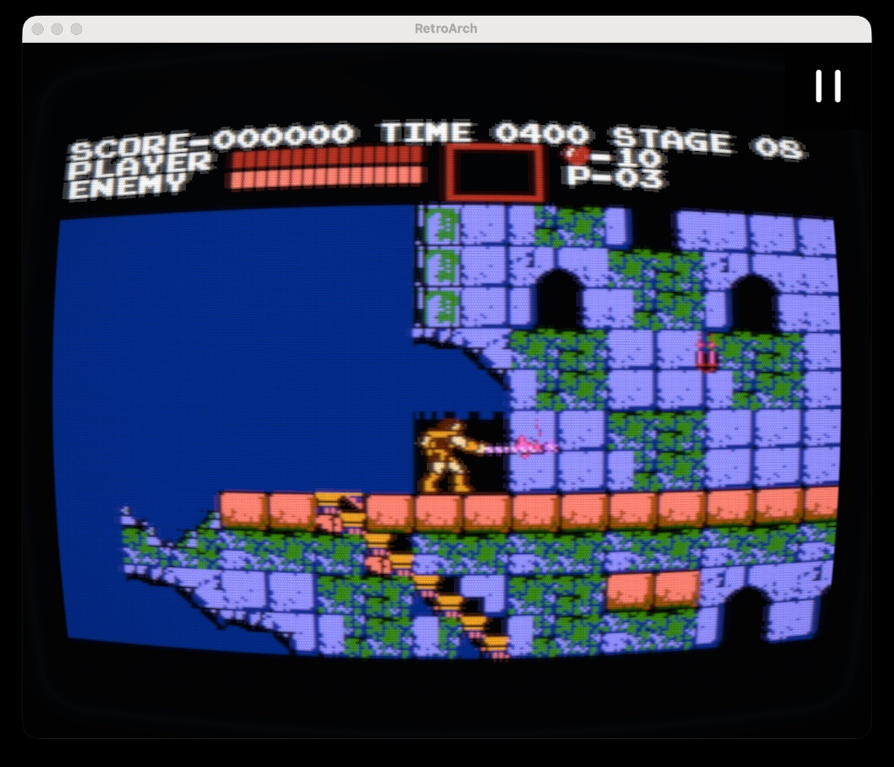
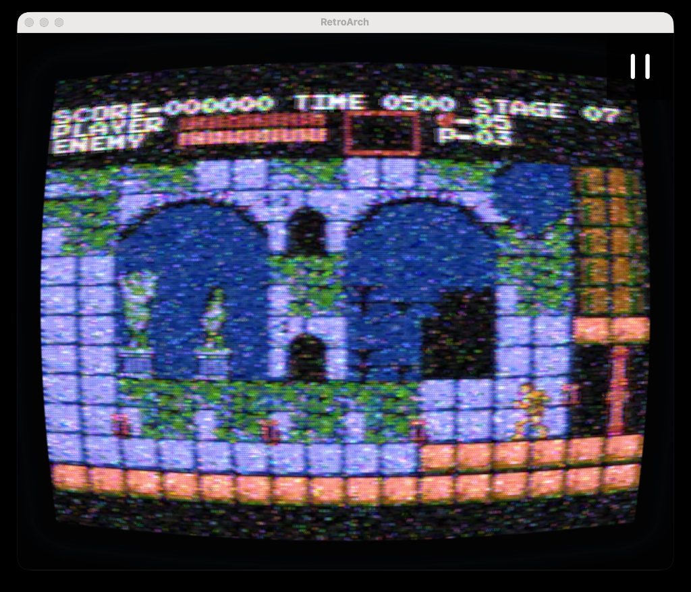

# Okusan CRT Dynamics

English | [日本語](docs/README.ja.md) | [Technical Notes](docs/ARCHITECTURE.md)

A two-pass CRT display shader pack for RetroArch focused on **beam current dynamics**: flyback high-voltage sag under bright scenes, 525-line NTSC 480i field alternation over 240p sources, subtle RGB gun convergence, P22-style phosphor persistence, and glass halation — paired with an optional NTSC RF modulation/demodulation preset (`okusan-crt-rf`).

Both **Slang** (`.slangp` / `.slang`, including native **HDR10** presets) and **GLSL** (`.glslp` / `.glsl`) pipelines are included in the same folder.

### `okusan-crt-rgb` (Clean RGB CRT)



### `okusan-crt-rf` (Weak-Signal NTSC RF Television)



## Features

- **Flyback HV Regulation Sag**: Pass 0 samples an 8×8 grid across the current and previous frames and smooths their squared luminance (`0.58` blend). When screen load exceeds `0.14` during bright scenes or flashes, the raster subtly expands outward and glass halation increases.
- **525-Line 480i Field Interlacing**: Alternates even and odd television fields (`FrameCount % 2`) with luminance-modulated beam width and attenuated alternate-field line illumination (`0.55`), or toggles cleanly to 240p progressive scanlines.
- **Clean RGB Beam Convergence (`okusan-crt-rgb`)**: Tight horizontal electron beam (`sigma = 0.55` texels) with subtle R/G/B gun convergence offsets (`-0.13`, `0.0`, `+0.16` texels).
- **P22 Decay, Halation & Slot Mask**: Short green/cyan-biased persistence compared against the previous frame (`PrevTexture` / `OriginalHistory1`), 4-tap axial glass scatter, rounded bezel silhouette, and viewport-scaled staggered RGB phosphor slots (`3.0`–`6.0` px pitch).
- **True NTSC RF Signal & Noise Emulation (`okusan-crt-rf`)**: Keeps `okusan-crt-rgb` untouched in a separate pass that encodes each scanline into YIQ + 3.58 MHz subcarrier (`2π/3` rad/texel), adds cable echo reflections (`-5` / `-10` px), injects scanline-independent 1D Gaussian + impulse RF noise onto the modulated waveform, and demodulates over a 6-tap full subcarrier cycle — naturally producing luma + subtle chroma snow, cross-color on fine white detail, dot crawl, weak-RF black lift, and slight line sync flutter.
- **Native HDR10 CRT Luminance & Physical ABL (`*-hdr.slangp`)**: Adds dedicated `A2B10G10R10_UNORM_PACK32` (Rec.2020 + ST.2084 PQ) Slang presets that compensate slot-mask light loss, boost bright phosphors above paper white under Pass 0 Automatic Beam Limiter (ABL) control, and preserve black levels cleanly.

## Presets

| Preset | Format | Target Drivers | Profile |
| --- | --- | --- | --- |
| `okusan-crt-rgb.slangp` | Slang | Metal, Vulkan, D3D11/12 | Clean 525-line 480i / HV-bloom RGB CRT (SDR) |
| `okusan-crt-rf.slangp` | Slang | Metal, Vulkan, D3D11/12 | NTSC RF modulation, snow & cross-color CRT (SDR) |
| `okusan-crt-rgb-hdr.slangp` | Slang (HDR10) | Vulkan, D3D11/12 (HDR ON) | Native HDR10 RGB CRT with physical ABL & mask boost |
| `okusan-crt-rf-hdr.slangp` | Slang (HDR10) | Vulkan, D3D11/12 (HDR ON) | Native HDR10 NTSC RF CRT with physical ABL & mask boost |
| `okusan-crt-rgb.glslp` | GLSL | OpenGL (`gl` / `glcore`) | Clean 525-line 480i / HV-bloom RGB CRT (SDR) |
| `okusan-crt-rf.glslp` | GLSL | OpenGL (`gl` / `glcore`) | NTSC RF modulation, snow & cross-color CRT (SDR) |

## Installation (RetroArch)

1. Copy the `Okusan-CRT-Dynamics` folder into your RetroArch shader directory (check **Settings → Directory → Video Shader**, under `shaders_slang/` or `shaders_glsl/`, or directly under `shaders/`).
2. *(For HDR10 presets)* Enable **Settings → Video → HDR → Enable HDR** using a driver/display with HDR10 swapchain support (e.g., Vulkan, D3D11, or D3D12). If you are running SDR or macOS without an HDR10 swapchain, use the standard `.slangp` presets.
3. Launch a game and open the **Quick Menu** (`F1` / `fn + F1` on macOS).
4. Go to **Shaders → Video Shaders → ON**.
5. Choose **Load Preset** → `Okusan-CRT-Dynamics` → **`okusan-crt-rgb`**, **`okusan-crt-rf`**, **`okusan-crt-rgb-hdr`**, or **`okusan-crt-rf-hdr`**.
6. *(Optional)* Go to **Shaders → Save → Save Global Preset** to keep it active automatically.

## Shader Parameters

| Parameter | Preset | Default | Range | Effect |
| --- | --- | --- | --- | --- |
| `OKUSAN_INTERLACED` | All | `1.0` | `0.0 - 1.0` | `1.0` = 525-line 480i fields, `0.0` = 240p scanlines |
| `OKUSAN_HV_BLOOM` | All | `1.0` | `0.0 - 2.0` | Flyback high-voltage sag raster expansion & halation boost |
| `OKUSAN_CURVATURE` | All | `1.0` | `0.0 - 1.5` | Tube barrel warp & curved face geometry |
| `OKUSAN_MASK_STRENGTH` | All | `1.0` | `0.0 - 1.5` | Staggered RGB phosphor slot mask strength |
| `OKUSAN_RF_SNOW` | RF / RF-HDR | `1.0` | `0.0 - 2.0` | RF waveform Gaussian/impulse snow, black lift & sync flutter |
| `OKUSAN_RF_SIGNAL` | RF / RF-HDR | `1.0` | `0.0 - 2.0` | Weak-signal AGC fade, cable echoes & 3.58 MHz subcarrier leaks |
| `OKUSAN_HDR_PAPER_WHITE` | `*-hdr` | `250.0` | `80.0 - 600.0` | Reference SDR paper white luminance in nits |
| `OKUSAN_HDR_MAX_NITS` | `*-hdr` | `800.0` | `200.0 - 4000.0` | Display peak luminance target in nits |
| `OKUSAN_HDR_BOOST` | `*-hdr` | `1.0` | `0.0 - 1.5` | Physical ABL peak luminance multiplier (`0.0` = 1:1 SDR parity) |
| `OKUSAN_HDR_EXPAND_GAMUT` | `*-hdr` | `0.0` | `0.0 - 1.0` | `0.0` = faithful Rec.709 CRT phosphors, `1.0` = expanded Rec.2020 gamut |

## Pipeline Overview

```
OrigTexture (N) + PrevTexture (N-1)
   │
   ▼  Pass 0: shaders/okusan-crt-beamload.{glsl,slang}  (32x32 float)
      Samples an 8x8 grid per frame, squares luma, blends 58% current / 42% previous
   │
   ▼  Pass 1: shaders/okusan-crt-{display,rf-display}{,-hdr}.{glsl,slang}   (viewport)
      RGB: Bezel SDF + HV bloom ─► 5-tap RGB beam ─► 480i/240p ─► P22 ─► Halation ─► Mask ─► [SDR | ABL+HDR10 PQ]
      RF : Bezel SDF + HV bloom ─► NTSC YIQ RF noise/demod ─► 480i/240p ─► P22 ─► Halation ─► Mask ─► [SDR | ABL+HDR10 PQ]
```

For full mathematical and implementation details, see [docs/ARCHITECTURE.md](docs/ARCHITECTURE.md).

## Compatibility Notes

- Handles power-of-two padded source textures cleanly in GLSL (`OrigInputSize` / `OrigTextureSize` and `InputSize` / `TextureSize`).
- Adapts phosphor slot pitch across HiDPI/Retina displays and standard 1x windows without oversized RGB blocks.
- **First-load shader cache**: On the very first load of a preset (especially Slang on Metal/Vulkan), RetroArch compiles the shaders into the driver cache, which can briefly cause audio crackling or a short stutter. Once cached on subsequent launches, playback runs cleanly; raising **Settings → Audio → Output → Audio Latency (ms)** (e.g. `96`–`128`) also helps prevent audio underruns.

## License

Released under the [MIT License](LICENSE).
