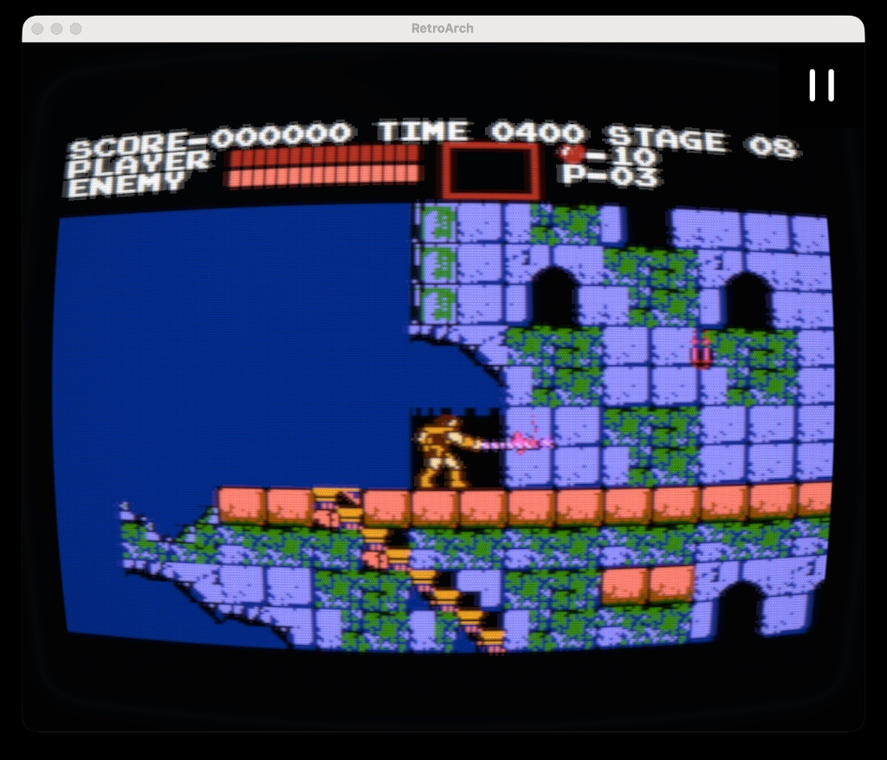

# Okusan CRT Dynamics（日本語解説）

[English README](../README.md) | [技術アーキテクチャ詳細 (English)](ARCHITECTURE.md)

**Okusan CRT Dynamics** は、家庭用 RGB ブラウン管テレビの落ち着いた発色と、映像信号に対する**管面の動的な振る舞い（高圧回路の垂れ・525本 480i フィールド交替・P22系蛍光体の残光）**を軽量な2パスで再現する RetroArch 用 RGB CRT シェーダです。

同一フォルダ内に **Slang**（`.slangp` / `.slang`）と **GLSL**（`.glslp` / `.glsl`）の両方を収録しています。

---

## 主な特徴

1. **高圧（フライバック）ブルームの再現**
   - Pass 0 が毎フレーム画面全体の2乗輝度をサンプリングし、前フレームとの減衰負荷を計算します。
   - 雷・爆発・全画面フラッシュなど輝度が急に上がった瞬間だけ高圧が少し垂れ、ラスタがわずかに外へ膨張してガラスハレーションも持ち上がります。
2. **NTSC 525本・480i インターレース描画（240p 切替可）**
   - `OKUSAN_INTERLACED = 1.0` では `FrameCount % 2` に応じて偶奇フィールドを交互走査しつつ、1フレーム前の残像と輝度に応じたビーム太さ変調を加えます。
   - `0.0` にするとクラシックな 240p プログレッシブ走査線へ切り替わります。
3. **クリアな RGB 電子銃とガラスハレーション**
   - R/G/B 3電子銃のわずかなコンバージェンスずれを伴うタイトな水平ビームに、P22 系の短い緑/シアン寄り残光、4近傍ガラス散乱ハレーション、曲面ベゼルリップを組み合わせています。
4. **解像度適応の千鳥 RGB スロットマスク**
   - 出力描画幅に応じてスロットピッチとマスク強度を自動調整し、HiDPI 環境でも通常ウィンドウでも細やかで自然なブラウン管の粒感を出します。

---

## プリセット

| プリセット | 形式 | 対応映像ドライバ |
| --- | --- | --- |
| `okusan-crt-rgb.slangp` | Slang | Metal (Mac標準), Vulkan, D3D11/12 |
| `okusan-crt-rgb.glslp` | GLSL | OpenGL (`gl` / `glcore`) |

---

## RetroArch への導入手順

1. `Okusan-CRT-Dynamics` フォルダを RetroArch のシェーダフォルダへコピーします（**設定 → ディレクトリ → ビデオシェーダ** 配下の `shaders_slang/` または `shaders_glsl/`、あるいは `shaders/` 直下）。
2. ゲームを何か1本起動し、**クイックメニュー**（`F1` / Mac では `fn + F1`）を開きます。
3. **シェーダ → ビデオシェーダ** を **ON** にします。
4. **読み込む (`Load Preset`) → `Okusan-CRT-Dynamics` → `okusan-crt-rgb`** を選択します。
5. 毎回自動で適用したい場合は **シェーダ → 保存 → グローバルプリセットを保存** を実行します。

---

## パラメータ一覧

| パラメータ名 | 初期値 | 範囲 | 調整内容 |
| --- | --- | --- | --- |
| `OKUSAN_INTERLACED` | `1.0` | `0.0 - 1.0` | `1.0`: 525本 480i 交互走査 / `0.0`: 240p 走査線 |
| `OKUSAN_HV_BLOOM` | `1.0` | `0.0 - 2.0` | 全画面フラッシュ時の高圧垂れ膨張とハレーション増加量 |
| `OKUSAN_CURVATURE` | `1.0` | `0.0 - 1.5` | ブラウン管の管面カーブの強さ（`0.0` でフラット） |
| `OKUSAN_MASK_STRENGTH` | `1.0` | `0.0 - 1.5` | RGB スロットマスクの濃さ |

---

## ライセンス

[MIT License](../LICENSE) のもとで公開しています。
